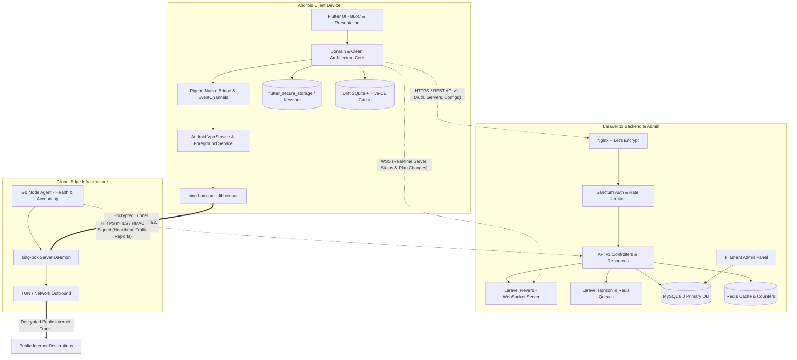
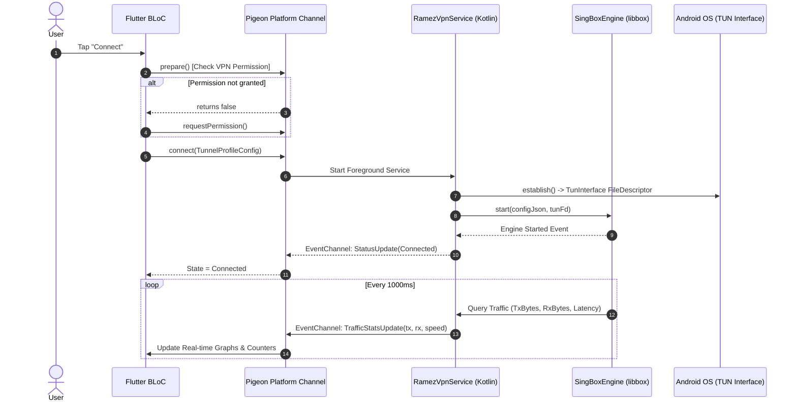

# Ramez Tunnel Plus — Architecture Blueprint (Phase 0)

## 1. System Overview & Macro Architecture

Ramez Tunnel Plus is a production-grade, enterprise-scale network tunneling system designed with a strict **Control Plane vs. Data Plane separation**.

- **Control Plane:** Laravel 11 (PHP 8.3+) with Filament Admin, MySQL 8, Redis, Laravel Reverb (WebSockets), and Laravel Horizon. It handles user authentication, device tracking, server health metrics, configuration issuance, subscription billing, and telemetry aggregation. **No user tunnel traffic ever passes through Laravel.**
- **Mobile Client:** Flutter (latest stable, Dart 3.x) targeting Android (API 26+) first. Uses Clean Architecture (Presentation, Domain, Data) with BLoC, Freezed, fpdart, Drift, Hive-CE, and FlutterSecureStorage.
- **Native Android VPN Engine:** Kotlin-based `VpnService` managing the OS TUN interface. Communicates with Flutter via Pigeon (typed RPC) and dual EventChannels (streaming connection state and high-frequency byte counters). Connects to a pluggable native engine: **sing-box core (`libbox`)** for MVP (VLESS, VMess, Trojan, Shadowsocks, Hysteria2, TUIC).
- **Edge Data Plane (Server Nodes):** Distributed VPS instances running `sing-box` server core inside Docker or native systemd, accompanied by a lightweight **Node Agent** (written in Go) that pushes traffic accounting metrics to Laravel over mTLS/HMAC-signed REST APIs and synchronizes active user credentials.



---

## 2. Layered Architecture: Mobile Client (Flutter & Kotlin)

### 2.1 Clean Architecture Pattern

The Flutter app strictly enforces single responsibility, modularity, and inversion of control across three layers per feature module:

```
apps/mobile/lib/features/<feature_name>/
├── presentation/
│   ├── bloc/          # Cubit/BLoC with Freezed state and events
│   ├── pages/         # Full screen widgets (Clean & responsive)
│   └── widgets/       # Feature-specific reusable UI components
├── domain/
│   ├── entities/      # Pure Dart immutable business models
│   ├── repositories/  # Abstract repository contracts (interfaces)
│   └── usecases/      # Single-responsibility use cases returning Either<Failure, T>
└── data/
    ├── datasources/   # Remote (Dio) and Local (Drift/SecureStorage) datasources
    ├── models/        # JSON serializable data transfer objects (DTOs)
    └── repositories/  # Concrete repository implementations
```

### 2.2 Storage Hierarchy & Security

| Data Type | Storage Mechanism | Encryption / Protection |
|---|---|---|
| User Tokens (Sanctum), Session Keys, VPN Secrets | `flutter_secure_storage` | Hardware-backed Android Keystore (AES-256-GCM) |
| Configuration Profiles, Connection Logs, Speed History | `drift` (SQLite) | Relational SQL schema with foreign keys and indexes |
| Temporary Cache (Server lists, Ping cache, UI state) | `hive_ce` | High-speed binary key-value store |
| Preferences (Theme, Language, Flags) | `shared_preferences` | Standard OS preferences (non-sensitive) |

### 2.3 Android Native Bridge & VpnEngine Interface

The platform interface is defined using `pigeon` specifications to guarantee compile-time safety and eliminate runtime type errors:



#### Kotlin `VpnEngine` Contract
```kotlin
package com.ramez.tunnelplus.vpn.engine

import kotlinx.coroutines.flow.Flow

sealed class ConnectionStatus {
    object Disconnected : ConnectionStatus()
    object Preparing : ConnectionStatus()
    object Connecting : ConnectionStatus()
    object Connected : ConnectionStatus()
    object Reconnecting : ConnectionStatus()
    data class Failed(val code: Int, val message: String) : ConnectionStatus()
}

data class TrafficStats(
    val txBytes: Long,
    val rxBytes: Long,
    val txSpeedBps: Long,
    val rxSpeedBps: Long,
    val pingMs: Int
)

interface VpnEngine {
    val protocolId: String
    fun supports(protocol: String): Boolean
    suspend fun start(profileJson: String, tunFd: Int)
    suspend fun stop()
    fun observeStatus(): Flow<ConnectionStatus>
    fun observeStats(): Flow<TrafficStats>
}
```

---

## 3. Control Plane Architecture: Laravel 11 Backend

### 3.1 Modular Organization (`apps/backend/app/Modules/`)

```
app/Modules/
├── Auth/              # Registration, Login, Sanctum, Password Resets, MFA
├── Users/             # User Profiles, Device limits, GDPR Erasure
├── Servers/           # Server registry, Load metrics, Health scheduler, GeoIP
├── Configurations/    # .rtp generation, Ed25519 signing, Argon2id encryption
├── Connections/       # Session tracking, Real-time lease tokens
├── Plans/             # Tier definitions (Free, Premium, Pro), Entitlements
├── Subscriptions/     # Google Play Billing, RTDN webhook listener, Lifecycle
├── Traffic/           # Node Agent accounting ingestion, quota enforcement
├── Notifications/     # FCM dispatch, targeted campaigns, topic broadcasts
├── AppRelease/        # Remote config, minimum supported version, force updates
└── NodeAgent/         # mTLS/HMAC authenticated endpoints for edge VPS nodes
```

### 3.2 Real-time Infrastructure & WebSockets

- **Laravel Reverb:** High-performance, native PHP WebSocket server running on port 8080.
- **Pushed Events:**
  - `server.status_changed`: Real-time ping, load percentage, and availability.
  - `user.subscription_updated`: Instantly unlocks/locks premium servers on the mobile client without requiring app restart.
  - `user.force_disconnect`: Fired when device limit is exceeded or account is revoked.

---

## 4. Edge Node Architecture & Server-Side Accounting

### 4.1 Node Agent (Go Daemon)

Every edge server runs an isolated Go binary `ramez-node-agent`:
1. **Health Monitor:** Measures CPU usage, RAM, network interface throughput, and ping back to Laravel every 15 seconds.
2. **Traffic Aggregator:** Queries the internal `sing-box` admin management API (`127.0.0.1:9090`) to read per-user traffic counters.
3. **Report Dispatcher:** Batches traffic usage every 60 seconds and submits an HMAC-SHA256 signed payload to Laravel: `POST /api/v1/agent/report-traffic`.
4. **Credential Synchronizer:** Polls `/api/v1/agent/sync-users` or listens to Redis/WebSocket to dynamically inject or remove user UUIDs/passwords from the running `sing-box` configuration without restarting the service (zero downtime reload).

---

## 5. Security & Threat Mitigation Architecture

1. **Anti-Tampering & Traffic Protection:**
   - Traffic accounting is **strictly server-side**. If a client modifies local byte counters, the backend cuts the connection once the edge server reports quota exhaustion.
   - Credentials issued to mobile apps are ephemeral lease tokens or per-user credentials. The root server SSH keys or administrative tokens are never exposed.
2. **DNS Leak & IPv6 Leak Prevention:**
   - The native TUN interface captures all IPv4 (`0.0.0.0/0`) and IPv6 (`::/0`) routes.
   - DNS requests are redirected inside the TUN directly to encrypted DoH (DNS-over-HTTPS) or sing-box internal DNS resolvers.
3. **Data Redaction & Zero-Logs Privacy:**
   - Edge server `sing-box` logging is configured to `log.level: "warn"` or `"error"`. Access logs (visited domains, URLs, destinations) are routed to `/dev/null`.
   - Client diagnostic logs strip tokens, passwords, private keys, and user public IP addresses before export.
