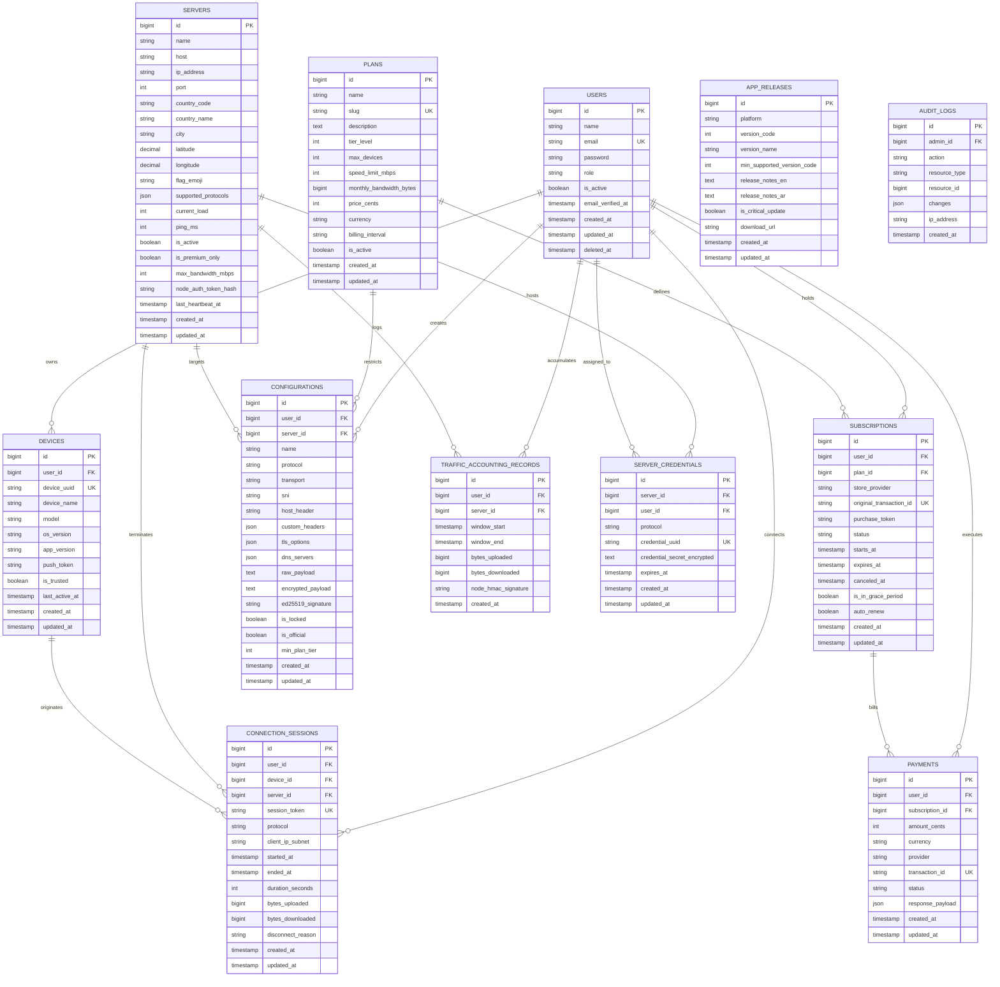

# Ramez Tunnel Plus — Database Entity Relationship Diagram & Schema (Phase 0)

## 1. Mermaid Entity-Relationship Diagram (ERD)

---

## 2. Comprehensive Table Specifications

### 2.1 `users`
| Column | Type | Constraints | Description |
|---|---|---|---|
| `id` | `BIGINT UNSIGNED` | PRIMARY KEY, AUTO_INCREMENT | Unique user identifier |
| `name` | `VARCHAR(191)` | NOT NULL | Full display name |
| `email` | `VARCHAR(191)` | NOT NULL, UNIQUE | User login email |
| `password` | `VARCHAR(255)` | NOT NULL | Bcrypt / Argon2id hashed password |
| `role` | `VARCHAR(50)` | NOT NULL, DEFAULT 'user' | Role: 'user', 'support', 'admin', 'super_admin' |
| `is_active` | `BOOLEAN` | NOT NULL, DEFAULT true | Account active flag |
| `email_verified_at` | `TIMESTAMP` | NULLABLE | Verification timestamp |
| `remember_token` | `VARCHAR(100)` | NULLABLE | Session remember token |
| `created_at` | `TIMESTAMP` | NULLABLE | Record creation |
| `updated_at` | `TIMESTAMP` | NULLABLE | Record update |
| `deleted_at` | `TIMESTAMP` | NULLABLE | Soft delete timestamp (GDPR retention) |

*Indexes:* `idx_users_email` (`email`), `idx_users_role` (`role`).

### 2.2 `devices`
| Column | Type | Constraints | Description |
|---|---|---|---|
| `id` | `BIGINT UNSIGNED` | PRIMARY KEY, AUTO_INCREMENT | Device record ID |
| `user_id` | `BIGINT UNSIGNED` | NOT NULL, FK -> `users.id` ON DELETE CASCADE | Associated user |
| `device_uuid` | `VARCHAR(191)` | NOT NULL, UNIQUE | Hardware/App generated unique ID |
| `device_name` | `VARCHAR(191)` | NOT NULL | User friendly name (e.g., "Pixel 8 Pro") |
| `model` | `VARCHAR(100)` | NULLABLE | Device model identifier |
| `os_version` | `VARCHAR(50)` | NULLABLE | Android OS version |
| `app_version` | `VARCHAR(50)` | NULLABLE | Ramez Tunnel Plus client version |
| `push_token` | `TEXT` | NULLABLE | FCM registration push token |
| `is_trusted` | `BOOLEAN` | NOT NULL, DEFAULT true | Trusted device status |
| `last_active_at` | `TIMESTAMP` | NULLABLE | Heartbeat activity |
| `created_at` | `TIMESTAMP` | NULLABLE | Registration date |
| `updated_at` | `TIMESTAMP` | NULLABLE | Update date |

*Indexes:* `idx_devices_user_id` (`user_id`), `idx_devices_uuid` (`device_uuid`).

### 2.3 `servers`
| Column | Type | Constraints | Description |
|---|---|---|---|
| `id` | `BIGINT UNSIGNED` | PRIMARY KEY, AUTO_INCREMENT | Server node ID |
| `name` | `VARCHAR(191)` | NOT NULL | Server label (e.g. "Frankfurt Fast-01") |
| `host` | `VARCHAR(191)` | NOT NULL | Fully qualified domain name |
| `ip_address` | `VARCHAR(45)` | NOT NULL | IPv4 / IPv6 address |
| `port` | `INT UNSIGNED` | NOT NULL, DEFAULT 443 | Primary inbound port |
| `country_code` | `CHAR(2)` | NOT NULL | ISO 3166-1 alpha-2 (e.g. "DE") |
| `country_name` | `VARCHAR(100)` | NOT NULL | Display country name |
| `city` | `VARCHAR(100)` | NOT NULL | City location |
| `latitude` | `DECIMAL(10, 8)` | NULLABLE | Map latitude |
| `longitude` | `DECIMAL(11, 8)` | NULLABLE | Map longitude |
| `flag_emoji` | `VARCHAR(10)` | NOT NULL | Flag unicode character |
| `supported_protocols` | `JSON` | NOT NULL | `["vless", "vmess", "trojan", "shadowsocks", "hysteria2"]` |
| `current_load` | `TINYINT UNSIGNED` | NOT NULL, DEFAULT 0 | CPU / Traffic Load percentage (0-100) |
| `ping_ms` | `INT UNSIGNED` | NOT NULL, DEFAULT 0 | Average measured latency |
| `is_active` | `BOOLEAN` | NOT NULL, DEFAULT true | Operational status |
| `is_premium_only` | `BOOLEAN` | NOT NULL, DEFAULT false | Tier barrier flag |
| `max_bandwidth_mbps` | `INT UNSIGNED` | NOT NULL, DEFAULT 1000 | Port capacity |
| `node_auth_token_hash` | `VARCHAR(255)` | NOT NULL | SHA256 hash for Node Agent auth |
| `last_heartbeat_at` | `TIMESTAMP` | NULLABLE | Node Agent last health check |
| `created_at` | `TIMESTAMP` | NULLABLE | Creation date |
| `updated_at` | `TIMESTAMP` | NULLABLE | Update date |

*Indexes:* `idx_servers_active_tier` (`is_active`, `is_premium_only`), `idx_servers_country` (`country_code`).

### 2.4 `configurations`
| Column | Type | Constraints | Description |
|---|---|---|---|
| `id` | `BIGINT UNSIGNED` | PRIMARY KEY, AUTO_INCREMENT | Profile configuration ID |
| `user_id` | `BIGINT UNSIGNED` | NULLABLE, FK -> `users.id` ON DELETE CASCADE | Custom user config or NULL if official |
| `server_id` | `BIGINT UNSIGNED` | NULLABLE, FK -> `servers.id` ON DELETE SET NULL | Target node |
| `name` | `VARCHAR(191)` | NOT NULL | Profile display title |
| `protocol` | `VARCHAR(50)` | NOT NULL | vless, vmess, trojan, ss, hy2, etc. |
| `transport` | `VARCHAR(50)` | NOT NULL, DEFAULT 'tcp' | tcp, ws, grpc, httpupgrade |
| `sni` | `VARCHAR(255)` | NULLABLE | TLS Server Name Indication |
| `host_header` | `VARCHAR(255)` | NULLABLE | WebSocket / HTTP host header |
| `custom_headers` | `JSON` | NULLABLE | Custom HTTP key-value headers |
| `tls_options` | `JSON` | NULLABLE | ALPN, fingerprint, certificate pinning |
| `dns_servers` | `JSON` | NULLABLE | Custom DNS list `["1.1.1.1", "8.8.8.8"]` |
| `raw_payload` | `TEXT` | NULLABLE | Unencrypted JSON profile representation |
| `encrypted_payload` | `TEXT` | NULLABLE | AES-256-GCM encrypted payload |
| `ed25519_signature` | `VARCHAR(255)` | NULLABLE | Official signature verified by client |
| `is_locked` | `BOOLEAN` | NOT NULL, DEFAULT false | Locked config (secrets hidden from user) |
| `is_official` | `BOOLEAN` | NOT NULL, DEFAULT false | Built-in official server profile |
| `min_plan_tier` | `INT` | NOT NULL, DEFAULT 0 | Minimum tier level required (0=Free, 1=Premium, 2=Pro) |
| `created_at` | `TIMESTAMP` | NULLABLE | Creation date |
| `updated_at` | `TIMESTAMP` | NULLABLE | Update date |

---

### 2.5 `plans`
| Column | Type | Constraints | Description |
|---|---|---|---|
| `id` | `BIGINT UNSIGNED` | PRIMARY KEY, AUTO_INCREMENT | Plan ID |
| `name` | `VARCHAR(100)` | NOT NULL | Plan name ("Free", "Premium VIP", "Pro") |
| `slug` | `VARCHAR(100)` | NOT NULL, UNIQUE | Identifier ("free", "premium-monthly") |
| `description` | `TEXT` | NULLABLE | Feature bullets |
| `tier_level` | `INT` | NOT NULL, DEFAULT 0 | 0 = Free, 1 = Premium, 2 = Pro |
| `max_devices` | `INT` | NOT NULL, DEFAULT 1 | Max concurrent active devices |
| `speed_limit_mbps` | `INT` | NOT NULL, DEFAULT 0 | 0 = Uncapped, or speed throttling limit |
| `monthly_bandwidth_bytes`| `BIGINT UNSIGNED` | NOT NULL, DEFAULT 0 | 0 = Unlimited data, or byte limit |
| `price_cents` | `INT UNSIGNED` | NOT NULL, DEFAULT 0 | Price in smallest currency unit |
| `currency` | `CHAR(3)` | NOT NULL, DEFAULT 'USD' | ISO 4217 Currency Code |
| `billing_interval` | `VARCHAR(20)` | NOT NULL, DEFAULT 'monthly' | 'monthly', 'quarterly', 'yearly' |
| `is_active` | `BOOLEAN` | NOT NULL, DEFAULT true | Visible in catalog |
| `created_at` | `TIMESTAMP` | NULLABLE | Record creation |
| `updated_at` | `TIMESTAMP` | NULLABLE | Record update |

---

### 2.6 `subscriptions`
| Column | Type | Constraints | Description |
|---|---|---|---|
| `id` | `BIGINT UNSIGNED` | PRIMARY KEY, AUTO_INCREMENT | Subscription ID |
| `user_id` | `BIGINT UNSIGNED` | NOT NULL, FK -> `users.id` ON DELETE CASCADE | Subscribed user |
| `plan_id` | `BIGINT UNSIGNED` | NOT NULL, FK -> `plans.id` | Target plan |
| `store_provider` | `VARCHAR(50)` | NOT NULL | 'google_play', 'stripe', 'crypto', 'manual' |
| `original_transaction_id`| `VARCHAR(255)`| NOT NULL, UNIQUE | Store transaction ID |
| `purchase_token` | `TEXT` | NULLABLE | Google Play purchase token |
| `status` | `VARCHAR(50)` | NOT NULL | 'active', 'expired', 'canceled', 'grace_period' |
| `starts_at` | `TIMESTAMP` | NOT NULL | Subscription valid start |
| `expires_at` | `TIMESTAMP` | NOT NULL | Expiry date |
| `canceled_at` | `TIMESTAMP` | NULLABLE | Cancellation request timestamp |
| `is_in_grace_period`| `BOOLEAN` | NOT NULL, DEFAULT false | Store grace period status |
| `auto_renew` | `BOOLEAN` | NOT NULL, DEFAULT true | Renewal preference |
| `created_at` | `TIMESTAMP` | NULLABLE | Record creation |
| `updated_at` | `TIMESTAMP` | NULLABLE | Record update |

*Indexes:* `idx_subs_user_status` (`user_id`, `status`), `idx_subs_expires_at` (`expires_at`).

---

### 2.7 `traffic_accounting_records`
| Column | Type | Constraints | Description |
|---|---|---|---|
| `id` | `BIGINT UNSIGNED` | PRIMARY KEY, AUTO_INCREMENT | Record ID |
| `user_id` | `BIGINT UNSIGNED` | NOT NULL, FK -> `users.id` ON DELETE CASCADE | User accounted |
| `server_id` | `BIGINT UNSIGNED` | NOT NULL, FK -> `servers.id` ON DELETE CASCADE | VPS Node reporter |
| `window_start` | `TIMESTAMP` | NOT NULL | Batch start interval |
| `window_end` | `TIMESTAMP` | NOT NULL | Batch end interval |
| `bytes_uploaded` | `BIGINT UNSIGNED` | NOT NULL, DEFAULT 0 | Total upstream bytes in window |
| `bytes_downloaded`| `BIGINT UNSIGNED` | NOT NULL, DEFAULT 0 | Total downstream bytes in window |
| `node_hmac_signature` | `VARCHAR(64)` | NOT NULL | Cryptographic proof from node |
| `created_at` | `TIMESTAMP` | NOT NULL | Record insertion |

*Indexes:* `idx_traffic_user_window` (`user_id`, `window_start`), `idx_traffic_server_window` (`server_id`, `window_start`).
