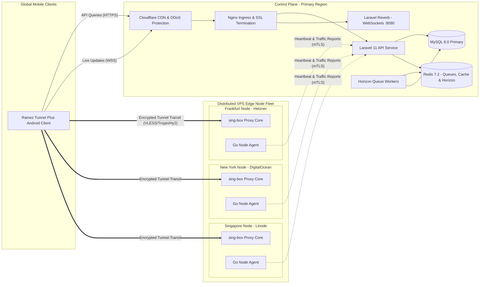

# Ramez Tunnel Plus — Infrastructure, Edge Nodes & Cloud Blueprint (Phase 0)

## 1. Hosting & Cloud Architecture Topology



---

## 2. Server Node Provisioning & OS Hardening

Every edge node runs **Ubuntu 24.04 LTS (x86_64 or ARM64)** provisioned via automated Ansible playbooks (`infra/ansible/provision-node.yml`).

### 2.1 Linux Kernel & Network Tuning (`/etc/sysctl.d/99-tunnel-tuning.conf`)
Edge nodes require high-throughput TCP and UDP buffering:
```ini
# Enable BBR TCP Congestion Control
net.core.default_qdisc = fq
net.ipv4.tcp_congestion_control = bbr

# Maximize file descriptor limits and socket buffers
fs.file-max = 1048576
net.core.rmem_max = 67108864
net.core.wmem_max = 67108864
net.core.netdev_max_backlog = 100000
net.core.somaxconn = 65535

# Fast socket recycling and reuse
net.ipv4.tcp_tw_reuse = 1
net.ipv4.tcp_fin_timeout = 15
net.ipv4.tcp_max_syn_backlog = 65535
net.ipv4.tcp_keepalive_time = 300
net.ipv4.tcp_keepalive_intvl = 15
net.ipv4.tcp_keepalive_probes = 5

# IPv4 & IPv6 Forwarding
net.ipv4.ip_forward = 1
net.ipv6.conf.all.forwarding = 1
```

### 2.2 sing-box Production Daemon Configuration
The proxy core runs as an isolated systemd service `sing-box.service`:
- **Management API:** Exposed locally on `127.0.0.1:9090` (restricted to the local Go Node Agent).
- **Inbounds:**
  - VLESS + Reality (TCP, Port 443 with SNI fallback)
  - Trojan + WebSocket (TLS, Port 8443)
  - Hysteria2 (UDP, Port 443 - custom QUIC congestion control)
  - Shadowsocks (2022-blake3-aes-128-gcm)
- **Zero Logging Policy:** Access logs piped to `/dev/null` to enforce zero-logs guarantee.

---

## 3. Go Node Agent Responsibilities & Telemetry Loop

The `ramez-node-agent` is deployed as a standalone lightweight binary:
1. **Heartbeat Loop (15s):** Evaluates CPU load, free memory, active connections, and network interface byte rates; transmits health packet to `POST /api/v1/agent/heartbeat`.
2. **Dynamic Credential Sync (60s):** Fetches the delta list of valid user UUIDs / passwords from `GET /api/v1/agent/sync-users` and hot-reloads sing-box inbounds without dropping existing connections.
3. **Traffic Quota Aggregation (60s):** Queries sing-box traffic counters per user UUID, signs the digest with the node's private secret via HMAC-SHA256, and submits to `POST /api/v1/agent/report-traffic`.

---

## 4. Domain & SSL/TLS Architecture

| Subdomain | Purpose | Target Service | Certificate Issuer |
|---|---|---|---|
| `api.rameztunnel.com` | REST API v1 & Control Plane | Laravel Nginx Gateway | Let's Encrypt (Automated Certbot) |
| `ws.rameztunnel.com` | Real-time WebSocket Gateway | Laravel Reverb (:8080) | Let's Encrypt |
| `admin.rameztunnel.com`| Filament Management Dashboard | Laravel Filament | Let's Encrypt (Restricted IP / MFA) |
| `*.nodes.rameztunnel.com` | VPS Node Ingress & TLS Termination | Individual VPS Edge Nodes | Cloudflare DNS-01 Challenge Wildcard |

---

## 5. Third-Party Integrations & Cloud Setup

### 5.1 Google Play Console & In-App Subscriptions
1. **Service Account:** Google Cloud service account with `androidpublisher` API permissions.
2. **RTDN (Real-Time Developer Notifications):**
   - Google Cloud Pub/Sub topic created and linked to the Google Play Console.
   - Laravel webhook endpoint (`POST /api/v1/webhooks/google-play-rtdn`) configured as a push subscriber to automatically handle renewals, grace periods, cancellations, and refunds.

### 5.2 Firebase Cloud Messaging (FCM)
1. Firebase Project `ramez-tunnel-plus` created.
2. `google-services.json` generated for Android package `com.ramez.tunnelplus`.
3. Firebase Admin SDK service account key mounted into Laravel (`apps/backend/storage/credentials/firebase-adminsdk.json`) for dispatching push notifications.
