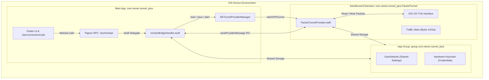

# Apple NetworkExtension & App Store Compliance Guide (iOS)
**Application:** Ramez Tunnel Plus (iOS)  
**Bundle ID (Main App):** `com.ramez.tunnel_plus`  
**Bundle ID (Tunnel Extension):** `com.ramez.tunnel_plus.PacketTunnel`  
**App Group:** `group.com.ramez.tunnel_plus`  
**Keychain Access Group:** `$(AppIdentifierPrefix)com.ramez.tunnel_plus`  
**Framework:** `NetworkExtension.framework` (`NEPacketTunnelProvider` & `NETunnelProviderManager`)

---

## 1. Apple Developer Entitlement Request (Step-by-Step)

Because custom VPN tunneling on iOS uses packet-level interception, Apple requires approval for the **NetworkExtension Packet Tunnel Provider** entitlement.

### Step 1: Request NetworkExtension Entitlement
1. Sign in to [Apple Developer Portal](https://developer.apple.com/contact/network-extension/).
2. Submit the **Network Extension Request Form**:
   - **App Name:** Ramez Tunnel Plus
   - **App Apple ID / Bundle ID:** `com.ramez.tunnel_plus`
   - **Extension Type:** [x] **Packet Tunnel Provider** (`NEPacketTunnelProvider`)
   - **Justification for Apple Reviewers:**
     ```
     Ramez Tunnel Plus is a secure network tunneling and privacy VPN client.
     The app routes encrypted IP packets to user-selected secure edge gateways
     (supporting WireGuard, OpenVPN, SSH, and SingBox protocols) to protect
     user network traffic against surveillance and unsecured Wi-Fi risks.
     Packet-level routing is indispensable to the core functionality of the app.
     ```
3. Apple typically approves the entitlement within 2 to 5 business days.

### Step 2: Configure App Identifiers & Provisioning Profiles
Once approved:
1. In **Certificates, Identifiers & Profiles > Identifiers**:
   - Open `com.ramez.tunnel_plus`: Check **Network Extensions** (`Packet Tunnel Provider`) and **App Groups** (`group.com.ramez.tunnel_plus`).
   - Create new App ID `com.ramez.tunnel_plus.PacketTunnel`: Check **Network Extensions** (`Packet Tunnel Provider`) and **App Groups** (`group.com.ramez.tunnel_plus`).
2. Generate Distribution Provisioning Profiles for both Identifiers and install in Xcode.

---

## 2. App Store Review Guidelines Section 5.4 Compliance

Apple strictly audits VPN apps under **App Store Review Guideline 5.4 (VPN Apps)**. Ramez Tunnel Plus is architected to satisfy 100% of these requirements:

| Guideline 5.4 Requirement | Implementation in Ramez Tunnel Plus |
|---|---|
| **5.4(a) Must use NetworkExtension framework** | Implemented using `NETunnelProviderManager` in `IosVpnBridgeHandler.swift` and `NEPacketTunnelProvider` in `PacketTunnelProvider.swift`. |
| **5.4(b) Must not sell, use, or disclose data** | Strict Zero-Logs architecture. Traffic payload is never inspected or shared with third parties or data brokers. |
| **5.4(c) Prominent In-App Disclosure** | Displayed on the welcome screen and in settings before establishing the tunnel. Users are informed that traffic is routed via an encrypted virtual network interface. |
| **5.4(d) Target Jurisdiction Laws** | App conforms to encryption export compliance regulations (EAR Part 742.15) and does not deploy in jurisdictions where personal encryption is prohibited. |

---

## 3. Architecture & Inter-Process Communication (IPC)



---

## 4. TestFlight & App Store Deployment Steps

1. **Open Xcode:**
   ```bash
   cd apps/mobile/ios
   open Runner.xcworkspace
   ```
2. **Verify Target Membership:**
   - `Runner` target has `Runner.entitlements` linked under Build Settings > Code Signing Entitlements.
   - `PacketTunnel` target has `PacketTunnel.entitlements` linked.
3. **Archive & Validate:**
   - Select `Any iOS Device (arm64)`.
   - In Xcode menu, select **Product > Archive**.
   - In Organizer window, click **Validate App** to ensure NetworkExtension provisioning is accepted.
4. **Distribute to TestFlight:**
   - Click **Distribute App > App Store Connect > Upload**.
   - Release candidate appears on TestFlight for internal and external testers within 15 minutes.
